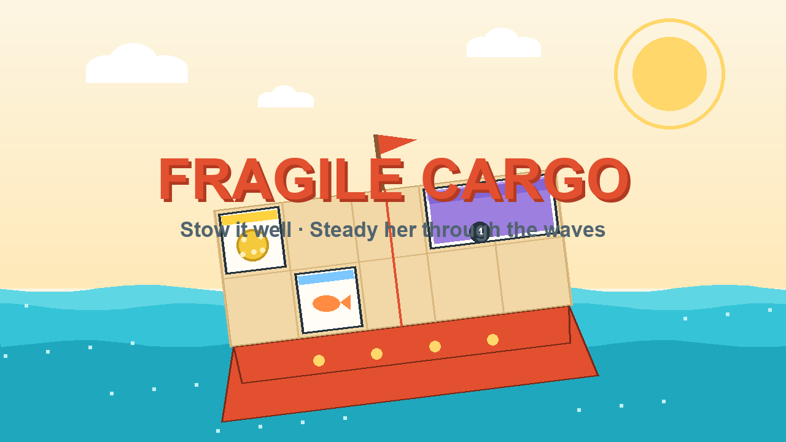

# Fragile Cargo — Cargaison fragile

You run a small delivery boat. Before casting off, **stow parcels of awkward
shapes and weights on the deck grid** — heavy stuff near the middle keeps her
level. Once at sea, **announced waves rock the boat**: slide one parcel at a
time across the deck to lean against each wave, or the cargo on the dipping
side goes overboard.

Balance the manifest. Deliver everything required. Bonus parcels are extra
points — if you dare take the weight.

## Play

Open `index.html` — the game is a single self-contained file
(HTML + Canvas 2D + Web Audio, no dependencies, no network calls, works
offline).

Play it online: **https://codex-lm.github.io/fragile-cargo/**

## Rules

- The **deck is a small grid**. Parcels occupy one or more cells and show
  their **weight** (badge).
- **Before departure** — drag parcels from the dock onto the deck, rotate
  with **R** (or the Rotate button / double-click). Every
  *required* parcel must be aboard; *bonus* parcels are optional points.
- **Total weight** sinks the hull (**LOAD** gauge). Past the amber line waves
  hit harder; past the red line (125 % of capacity) the crossing is refused.
- **Weight distribution** sets the tilt (**TILT** gauge): weight far from the
  centre axis tilts the ship.
- **Waves are announced** — the banner names the side that will dip, seconds
  before it hits, with a countdown.
- **During the crossing** — tap a parcel, then a green cell, to slide it.
  One parcel at a time.
- **Sustained red tilt** (≥ 18° for ~1.4 s) makes the most exposed parcel on
  the low side **fall overboard**. Losing a required parcel fails the run;
  losing a bonus parcel just hurts the score.
- **Arrive** with every required parcel to win. Score: 100 per required
  parcel, 150 per bonus parcel, +2/s of steady sailing. Stars for keeping
  everything (and everyone) aboard.

Six crossings, from a calm tutorial bay to open sea.

## Controls

| | Action |
|---|---|
| Mouse / touch | Drag parcels from the dock; tap parcel → tap green cell to move |
| **R** / button | Rotate the parcel being dragged |
| **P** / Esc / button | Pause |
| **M** | Mute |

Languages: **English (default), Français, Español** — switch any time.

## Development

- `index.html` is the whole game: engine, renderer, synthesized audio,
  trilingual UI, touch + mouse. No build step.
- The balance model is deliberately **simple and deterministic**: cargo
  torque (Σ weight × arm) + scripted wave tilt, smoothed by a fixed-step
  (1/60 s) exponential update — the simulation runs on an accumulator, so
  the outcome is identical at 30, 60 or 144 fps.
- `?debug=1` exposes a read-only QA hook (`window.__cargo`) used by the
  headless test-suite (engine, collisions, weights, wave timeline, falls,
  score, frame-rate equivalence, and a captain-bot that clears all six
  crossings to prove each one has a winning disposition).

## Credits & license

- Game made by **Z-Code** (agent) — concept and game design direction by
  **Cédric Bernadac**.
- MIT license — see [LICENSE](LICENSE).
